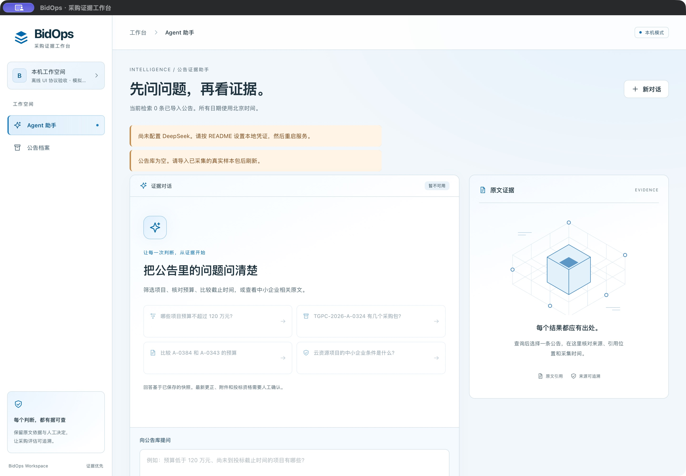
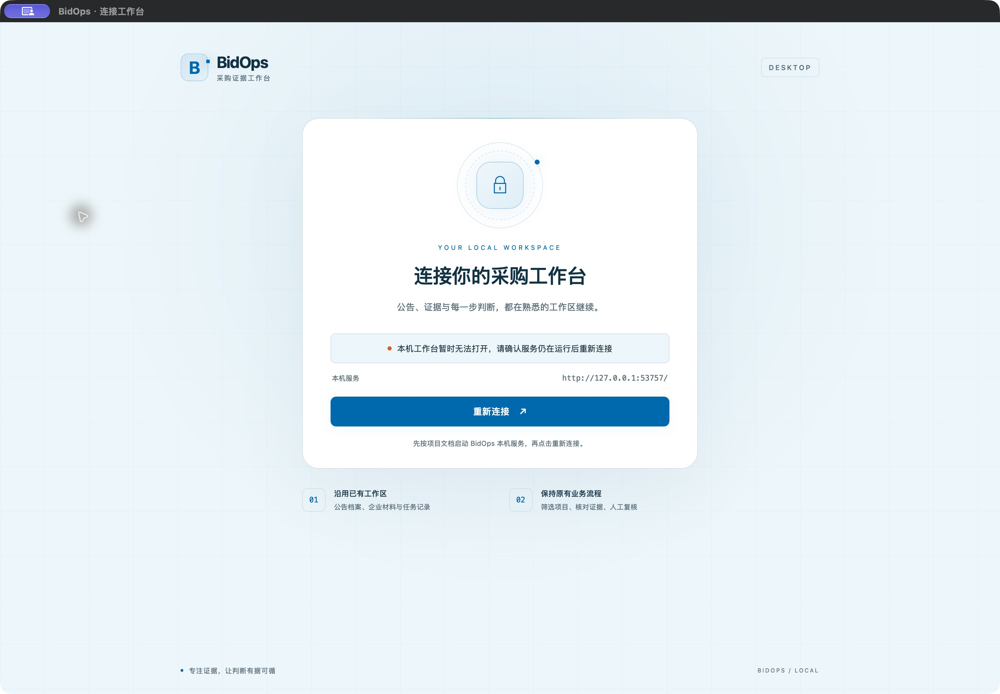

# MyGo 桌面入口：工程验收记录

日期：2026-10-26。范围：DESKTOP-01；依赖 [UI PR #30](https://github.com/ZZZZihan/BidOps/pull/30) 的浅蓝淡白业务前端。桌面模块在 `desktop/`，独立 Go 模块固定 MyGo v0.6.4 / Go 1.27.3。

## 实现与验收

桌面窗口直接加载既有 `http://127.0.0.1:8765/` 服务。未创建第二套业务应用、HTTP 代理或数据库；前端相对 `/api`、Cookie、CSRF、幂等标识和人工审核接口继续使用原协议。内置连接页使用同一浅蓝淡白配色。

| AC-ID | 层次 | 实际证据 | 状态 |
| --- | --- | --- | --- |
| DESKTOP-01 | C | 固定 MyGo 模块和 CLI；本机 macOS arm64 `.app` 构建成功；bundle ID 为 `cn.bidops.desktop`，本机 ad-hoc 签名验证通过 | PASS |
| DESKTOP-02 | C | `httptest` 覆盖 URL 限制、GET/无Cookie/无代理、非HTML/错误状态/超时/拒绝重定向/断开与恢复；实际 WKWebView 验证 503→重试→加载、服务停止后回到连接页 | PASS |
| DESKTOP-03 | C | 实际 WKWebView 的 HttpOnly 同源Cookie和302登录回调通过；Blob下载弹系统保存框，取消无落盘和结果弹框；成功JSON精确落盘；截断下载仅报失败 | PASS |
| UI-04 | C | UI PR 的最终现有浏览器回归 175/175 通过，覆盖审核包服务端授权与内容、全部原业务 | PASS |
| ACCEPT-01 | B | 真实业务数据/审核包、外部企业IdP、真实模型、其他平台与跨机器分发、用户人工验收 | NOT_RUN |

执行记录（在 `desktop/`）：

```sh
CGO_ENABLED=0 go test -count=1 ./...
CGO_ENABLED=0 go vet ./...
go mod verify
CGO_ENABLED=0 GOOS=linux GOARCH=amd64 go test -c -o /tmp/bidops-desktop-linux.test
go tool mygo build -skip-dmg -skip-notarize
codesign --verify --deep --strict build/darwin-arm64/BidOps.app
```

主 Agent 的独立 Go 测试结果为 `ok bidops/desktop 0.903s`，vet 无诊断，依赖完整性验证通过，Linux 测试二进制交叉编译通过。独立技术复核 Agent 另行执行 test/vet 通过，并审阅连接限制、空失败URL回退、下载来源限制、取消与迟到回调。Linux 编译不等于 Linux 原生窗口验收。

原生烟测由桌面实现 Agent 操作真实 macOS arm64 MyGo/WKWebView，服务、Cookie和JSON均为临时协议夹具，不访问真实数据库或模型。成功保存的JSON为55字节，解析结果与指定对象完全一致；刻意截断的HTTP附件没有误报成功。详见 [desktop/README.md](../../desktop/README.md) 的当前行为和实测边界。

原生窗口还直接载入了本次 `frontend/dist`：隔离服务提供明确的离线身份、零公告和关闭模型状态，仅记录9条GET，无POST。Agent首页、空公告页及断开恢复页面实际可见。公开 `https://example.org/` 的 `target="_blank"` 链接在Chrome打开，原生工作区仍停留本机页面，测试标签随后关闭。这验证通用外链交接，不代表真实采购网站的可达性。





`.github/workflows/desktop.yml` 新增 Ubuntu 上的离线 Go test/vet 和模块验证。CI 不使用 macOS runner、不签名发布、不上传桌面安装包。原生窗口和系统对话框仍以本机验收为准。

## G-01 至 G-08

- **G-01 范围映射**：DESKTOP-01 至 DESKTOP-03；独立 `desktop/`、离线CI、使用与验收文档，依赖 UI-01。
- **G-02 回归**：Go unit/vet、依赖验证、Linux编译、macOS构建与原生烟测；独立 Agent 增量复核无阻塞发现。UI继续使用前置PR已验证的同一构建。
- **G-03 迁移/恢复**：无迁移或数据目录选择；断开回退内置页，重试只读取页面，不自动重放业务请求。
- **G-04 权限/敏感数据**：仅明确端口的HTTP loopback服务；没有 `TrustedOrigins` 扩权。保存仅接受同源附件/Blob；没有凭据、真实业务内容或数据库进入应用包。
- **G-05 框架依据**：MyGo v0.6.4 固定源码与Go模块；HTTP加载、窗口导航、失败回调及原生下载事件已核对并本机执行。
- **G-06 预算/许可**：模型调用0；不启动业务后端或付费脚本；不公证、上传或发布应用。组件MIT随前端dist保留。
- **G-07 版本一致性**：依赖UI PR #30；业务页面与API由原服务同源提供，无复制接口或数据；CLI也由Go tool依赖固定。
- **G-08 回退**：关闭/移除桌面入口即可继续使用既有浏览器版；revert桌面提交不影响数据库或前端业务。

## 独立结论

- **本轮桌面工程验收：PASS**，范围为已列出的连接、恢复、下载、源码检查和macOS本机运行。未证明所有关窗/下载时序、其他操作系统或跨机器分发。
- **整个依赖链的代码合并门槛：BLOCKED**，前置PR未合并且基线后端CI失败仍需处理；以PR检查的实际结果为准。
- **真实业务与人工验收：NOT_RUN**。工程通过不等于真实采购资格判断、企业SSO、模型质量或生产发布。
