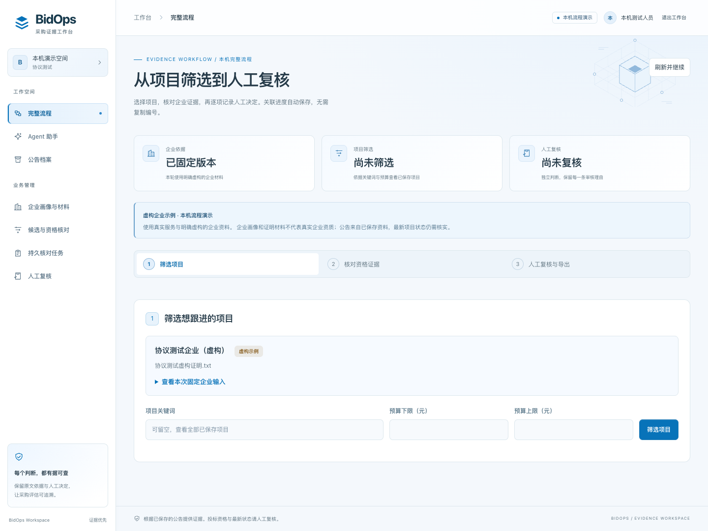
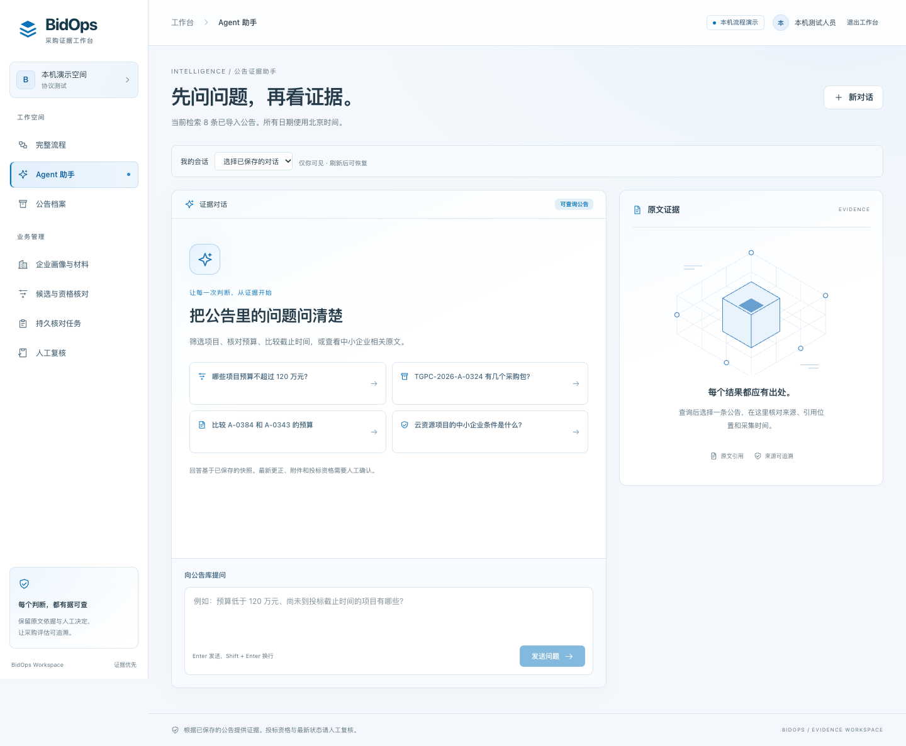

# 浅蓝淡白科技工作台：UI 验收记录

日期：2026-10-26。范围：UI-01；计划见 [TECH-WORKBENCH-PLAN.md](../TECH-WORKBENCH-PLAN.md)。基线 `fcd5e1b9ad9ba752bf9c45f607723f5eaaa5a25c`，工作分支 `feature/tech-workbench-ui`。

## 结果

现有 BidOps 前端已统一为浅蓝淡白工作台。导航、Agent 提问、原文证据、完整流程、企业资料、任务、人工审核和导入审计共享主题；业务函数与接口合同保留。实际接入七组 21st.dev 发布组件的公开上游适配：Sidebar、Button、Badge、Card、Empty、Prompt Input、Glow Card。没有新增运行依赖。

| AC-ID | 层次 | 执行与结果 | 状态 |
| --- | --- | --- | --- |
| UI-01 | C | 九个视图共用主题；七组真实组件适配；来源固定提交与三份 MIT 全文随代码保存；构建输出 `THIRD-PARTY-LICENSES.txt` | PASS |
| UI-02 | C | 独立 Agent 对照基线复核入口/渲染条件及请求逻辑；175 条回归覆盖身份、CSRF、幂等恢复、CAS、失权清理、授权导出 | PASS |
| UI-03 | C | 完整流程与实际临时后端用例覆盖五态、缺件、冲突、固定版本、独立人工理由和原判断保留 | PASS |
| UI-04 | C | 最终 `npm run build` 通过；完整 175 tests / 14 files，175 passed，耗时 1.8m | PASS |
| UI-05 | C | 桌面 1440px、手机 390px 截图复核；无页面横向溢出、无 pageerror；减少动效时 GlowCard 关闭；已有键盘、输入法与禁用语义保留 | PASS |
| ACCEPT-01 | B | 用户视觉确认、真实采购资料、真实模型、企业 IdP/HTTPS、生产环境不属于本轮离线验证 | NOT_RUN |

最终命令（工作目录为 `frontend/`）：

```sh
npm ci
npm run build
BIDOPS_BROWSER_PORT=4192 BIDOPS_NETWORK_ENABLED=false BIDOPS_BROWSER_CHANNEL=chrome \
  npm run test:e2e -- --workers=2 --global-timeout=180000
```

最终构建为 55 个模块，JS 约 430.83 kB（gzip 127.16 kB），CSS 约 69.78 kB（gzip 12.94 kB）。MIT 汇总文件包含 shadcn/ui、Prompt Kit、Glow Card Grid、React 与 React DOM 的完整声明。`git diff --check` 通过。

本机测试环境独立创建，Python 3.12 使用冻结主依赖与 hashed durable/attachments overlays，不复用原工作树的可写环境。第一次 16 workers 运行中 company 临时后端未及时启动；第二次 4 workers 的 runner 未正常收敛，已停止自建进程，Jobs 两条独立重跑通过；最终按上述 2 workers 命令取得完整 175/175 结果。没有修改测试来跳过失败，也没有使用真实模型。

## 可审阅的视觉证据

以下截图使用测试自行编写的协议响应和明确虚构的企业信息。它们证明布局与状态呈现，不代表已导入真实采购资料或模型质量。





[手机首屏](assets/tech-ui-agent-mobile.png) · [手机提问与证据区](assets/tech-ui-agent-mobile-composer.png)

## G-01 至 G-08

- **G-01 范围映射**：改动限定前端展示、组件/许可、本机测试端口隔离及对应文档；需求映射 UI-01 至 UI-05。
- **G-02 相关回归**：最终完整 175 条通过，另有视觉/减少动效检查与独立 Agent 源码复核。协议替身、实际临时后端与人工验收分别记录。
- **G-03 迁移/恢复**：不改 schema、数据库、账本、launcher 或迁移。原任务恢复与幂等用例通过，切页只重置页面滚动位置。
- **G-04 权限与敏感数据**：身份、导航权限、CSRF 与失权清理保持；截图为 authored fixtures，无真实用户或企业材料。
- **G-05 框架依据**：沿用 React 19 / TypeScript / Vite；组件公开上游、固定版本和适配边界见 [来源说明](../UI-COMPONENT-SOURCES.md)。
- **G-06 外部调用预算/许可**：未运行付费模型路径，新增组件无运行依赖；开源源码与 MIT 归属保留到源代码及 `dist`。
- **G-07 版本一致性**：原 `api.ts`、`backend/`、`tests/`、`scripts/`、提示与评分器无改动；构建和测试使用新工作树、独立预览端口，禁止复用其他 worktree 的服务。
- **G-08 回退**：前端提交可单独 revert 后 `npm ci && npm run build`；无数据回退步骤。UI PR 依赖基线业务 PR，未合并、未部署。

## 既有阻塞与独立结论

基线 PR #29 的 backend CI 已有 `test_collected_usage_cannot_override_original_saved_result` 失败。两个基线运行分别为 [40229757930](https://github.com/ZZZZihan/BidOps/actions/runs/40229757930/job/121278745659) 与 [40229760343](https://github.com/ZZZZihan/BidOps/actions/runs/40229760343/job/121278753652)，均 1 failed / 2279 passed / 1 skipped。测试 manifest 仍为 `qualification-v1`，实际提示版本已为 `qualification-v7-evidence-completeness`，严格校验因此失败。该问题先于本轮，不通过降低校验或改业务代码绕过。

- **本轮 UI 代码验收：PASS**，依据为构建、175 条回归、视觉检查和独立技术复核。
- **整个依赖链的代码合并门槛：BLOCKED**，基线 backend CI 问题尚待独立修复，且本轮 PR/前置 PR 未合并。
- **业务/人工验收：NOT_RUN**，不能将本轮工程通过等同于真实业务、用户视觉确认或生产交付。
