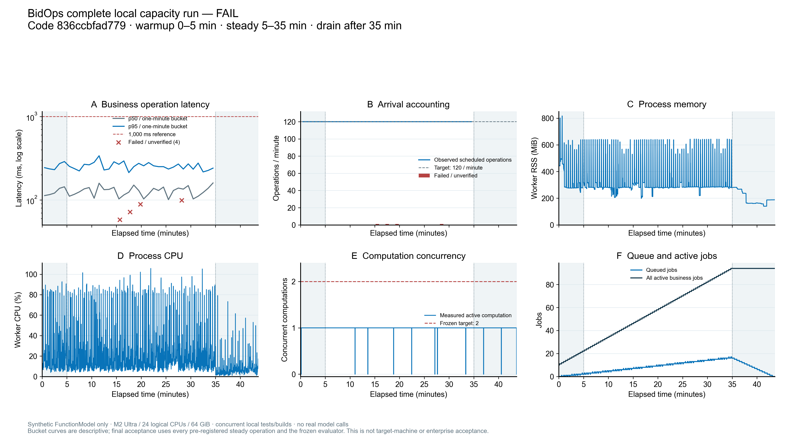

# B09 容量、告警与完整恢复验收报告（工程C通过、容量FAIL／业务BLOCKED，2026-10-23）

**完整正式本机容量运行已自然结束，exit1，容量结论FAIL。** 固定836代码在完整规模上执行4200次预登记逻辑操作（600预热＋3600稳态）；API性能、输入／数据完整性和离线模型模拟通过，但声明与实测计算并发均为1，低于冻结目标2，双计算重叠0ms，不能因延迟通过而改判。稳态4次ReadError全部保留，错误率4／3600＝0.1111%；非模型API P95＝263ms、受理P95＝108ms。开发机非目标硬件，measurement及recovery均BLOCKED，真实业务验收全部BLOCKED／NO_GO。最终代码db4的远端CI实际2010后端、152浏览器及检查通过；四个工程C关闭，与容量及人工验收分开。

当前确定的结论是：冻结计算目标为 **2**，实现实际只有 **1** 个资格计算槽，该差距必须 **FAIL**；真实目标硬件、真实模型吞吐、真实企业收件、最新权限和业务完成 RTO 未获验收，相应 B 项保持 **BLOCKED／NO-GO**。本机工程、合成数据、协议账号和 FunctionModel 的结果不能更名为真实企业或目标机结果。

本报告按显式白名单归档安全证据；原始负载目录保持受控、只读，不公开数据库、正文、身份标识或完整 trace。正式负载的 report／trace、完整 JSONL 及 EOF 已逐项核对；db4 CI、36ef 完整回归、原本机与 Linux 失败分别固定版本和原件哈希，不从多次运行中挑选最好成绩。

## 固定输入、版本与并行环境

正式 manifest 是 [manifest.json](evidence/b09-20261023/manifest.json) 的原始字节，SHA256 **`bd82c7ab050a53610742515d4af082140f6fce5593b203cabaa4e847ffb4a170`**，未因装载失败、开发机配置或单槽实现而下调。

| 维度 | 冻结值 |
| --- | --- |
| 业务与账户 | 1 企业、20 账号、10 个不同账号绑定的活跃客户端 |
| 公告／包件 | 10,000 公告版本、50,000 采购包，正文每版本4,096 bytes，共40,960,000 bytes |
| 内部材料／附件 | 200×16,384=3,276,800 bytes；1,000×16,384=16,384,000 bytes，均为合成数据 |
| 目标硬件 | 4 logical CPU、8,589,934,592-byte RAM、21,474,836,480-byte 可用本地磁盘 |
| 窗口 | 预热300秒＋稳态1,800秒，最长drain900秒；不能事后选窗口 |
| 到达 | 总2逻辑操作/秒、±5%、60秒bucket，迟滞≤1,000ms；10client各思考5,000ms、稳态至少180次 |
| 逻辑操作 | 78% read/search、18% task status、2% submit、2% review；全窗口4,200次、稳态3,600次 |
| 请求与采样 | 稳态HTTP timeout10秒、0次自动重试；资源每1秒采样，最大间隙2秒 |
| 业务／计算限制 | 单ASGI worker、最多100活跃业务任务；**target compute2/configured1**，要求稳态至少30秒双计算重叠 |
| 各正文限额 | JSON16,384 bytes、材料上传2,000,000 bytes、规范文本200,000字符；普通私有结果/raw10,000,000 bytes |
| 资格计算 | 12请求、90秒、120,000 input bytes、6,000 output tokens；每job两次本地FunctionModel等待各15秒、总30秒，允许偏差1,500ms |
| 目标门槛 | 非模型API及受理P95≤1,000ms，错误率严格<1%；RPO≤86,400秒、RTO≤1,800秒，含授权核验与业务可用 |

实际主机是本机开发机，辅助现场快照见 [hardware-auxiliary-snapshot.json](evidence/b09-20261023/hardware-auxiliary-snapshot.json)。该辅助快照不是负载开始前的硬件 pin，不替代正式 harness 的硬件记录。**Apple M2 Ultra／64GiB 开发机不等价于目标4CPU／8GiB**；不同配置不能按线性比例推断目标达标。

协调者已明确：正式本机负载期间**同机并行**执行 B09 full backend、前端构建和浏览器检查，各自隔离数据目录，但会争用 CPU、RAM、磁盘和调度。不得声明独占机器，不把这些争用引起的错误/延迟排出分母。正式input-pin记录实际24 logical CPU、68,719,476,736-byte RAM、152,031,666,176-byte可用本地盘；这仍不等价于目标硬件。[阶段性准备及输入pin摘要](evidence/b09-20261023/current-setup-summary.json)只公开计数与hash，不带PID或业务标识。当前运行状态快照和完整代码/计划 hash 见 [pending-final-runs.json](evidence/b09-20261023/pending-final-runs.json)。

当前计划为原69项＋此前实施新增B04-08＋本次B09-08，共 **71项专项AC**；B10之前有65项，另有G-01～G-08。该计数不把新增条目伪称原冻结条目。

## 正式运行记录——最终代码CI通过，固定836本机容量FAIL

| 项目 | 已知输入／命令与位置别名 | 当前状态 |
| --- | --- | --- |
| 完整本机负载 | `.venv/bin/python scripts/capacity_probe.py --output work/capacity-local-836ccbfad779-01 --manifest evals/capacity-v1/manifest.json --manifest-sha256 bd82c7ab050a53610742515d4af082140f6fce5593b203cabaa4e847ffb4a170`；没有`--unit-smoke` | **自然exit1／capacity FAIL**。候选准备10,584ms单列于定时窗口外；完整4200／稳态3600，4次ReadError全部计入。正式UTC起点21:20:53.933801Z；结束offset2,618,000ms（43分38秒，drain518秒）。精确结束wallclock未记录，不把22:05:00.433186Z的事后观察时间当结束时刻。完整安全结果见下节 |
| 最终整合检查 | 原836失败保留；36ef完成迁移预期修正后full；db4纳入身份测试时间修复及上游文档 | **36ef完整2006 passed／622.67秒，Ruff／247格式／freeze exit0、clean；未包含新增4项身份边界。最终db4实际LinuxCI2010 passed／675.52秒，三个job全PASS；36ef本机2006与db4实际2010分列**。原836本机2005／1、Linux2004／2仍为失败；本机152前端teardown和远端自然152分列 |
| 本地工程恢复 | `46ef2f7…` 上49个精确选择及一次完整全存储损失/失败关闭演练，另有20个恢复测试中的PDF/ingestion/review覆盖 | 已实际完成的**历史本机工程证据**，不归属新836ccbf的整合成绩。真实权限未恢复、业务未开放，RTO=null/BLOCKED |

一次逻辑review可能含依赖GET，登录刷新还有额外HTTP；4,200是逻辑操作，**不是全部HTTP请求数**。本报告分别核对 `requests` 与 `http-accounting`，包括认证开销、所有failed/timeout/missing/late/429/5xx；不得只用成功请求算P95或错误率。准备完整候选的300秒客户端deadline单列，不计入稳态10秒timeout/P95，也不消除准备的真实耗时或失败。

## 先前真实失败与针对性诊断

- 在 `46ef2f7b012d82314d6f324d9c6c03cd24cf947c`，完整负载 **FAILED_BEFORE_WARMUP**：`setup_freeze_complete_candidate_batch` 的10秒客户端等待发生 `ReadTimeout`，UTC `2026-10-22T20:56:39.970200+00:00`。没有 clock/plan、没有有效测量窗口，不能记作容量通过。[原安全失败记录](evidence/b09-20261023/historical-prewarmup-failure.json)
- 更早 `159f573b…` 由协调者为更新 watchdog 因果时间戳而在预热前中止，没有测量；[安全中止摘要](evidence/b09-20261023/historical-aborted-before-warmup.json)保留退出130和3000版本的最后seed记录。不能冒充完整运行，也不能删除该中止以只留后一场。
- 同批实际合成1万版本／5万包只读诊断：完整候选构建 **43.972041秒**，序列化结果单体 **37,690,586 bytes**，已大于旧普通10,000,000-byte存储限额；包查询计划存在SCAN。没有HTTP或鉴权验收。[旧诊断](evidence/b09-20261023/historical-candidate-diagnostic.json)
- 在复制的隔离库添加匹配索引后，构建 **3.712809292秒**、严格校验 **1.203841542秒**，包查询变为 `SEARCH … USING INDEX nd_package_versions_version_package(version_id=?)`；原库前后哈希相同、原库写入0。[索引诊断](evidence/b09-20261023/historical-index-diagnostic.json)
- 只读公开文本完整重校验40,960,000 bytes耗时 **5.600956秒**，说明页面/正文完整性和授权之外的全闭包重校验也有成本；该诊断不是目标机SLO。[摘要](evidence/b09-20261023/historical-readpath-summary.json)

B09-08因此新增 additive 012索引、严格完整候选专用≤50,000,000-byte通道、review默认20/最多100分页和≤60,000,000-byte完整导出。普通save/raw保持10MB，不能只把kind改成candidate就扩大容量；超限明确413，不截断。37.69MB数字不是“完整端到端负载已通过”。

另外保留环境／测试失败：旧 `46ef2f7…` full run因未装已锁pypdf overlay，**4个collection errors／2.24s、exit2**；未执行出完整通过。早期review浏览器32项因bundled Chromium executable缺失全部启动失败；后显式Chrome channel的32项通过，两者均保留。健康路由初期断言有1失败，随后修复及因果时间回归通过；报告不删除旧红测。[历史检查摘要](evidence/b09-20261023/historical-test-results.json)、[旧full失败](evidence/b09-20261023/historical-full-collection-failure.json)

## B09-08 完整50,000单元审阅与完整导出补证

现已在停止的旧全规模输入的**独立副本**上，通过当前836生产ScreeningService／QualificationRepository／JobsRepository／ReviewRepository／ReviewService完成检查，进程exit0；不是501条夹具，也没有复用正在运行的正式负载库。实际20合成账号、10,000公告版本、50,000采购包；完整批次保留49,995 excluded与5 needs_verification，不能称50,000个合格项目。[安全摘要](evidence/b09-20261023/full-review-proof/PUBLIC_ENGINEERING_SUMMARY.md)、[完整安全计数与hash](evidence/b09-20261023/full-review-proof/safe-result.json)

实际完整批次stored envelope **37,692,100 bytes**，经候选专用50,000,000-byte通道保存。第二个实际已分配的合成账号读取最后页offset=49,900／limit=100，返回100条、total=50,000、has_more=false，顺序ID与固定完整批次尾部精确相等，offset=50,000为空。完整导出 **37,703,148 bytes**，保留50,000 items和10,000 public versions，导出batch与固定存储batch精确相同。导出SHA256为`5fbb2844f77d43b9ea4801425d74c5199465191984a74fd34b7d3ee873123789`。

另行在同完整导出形状上通过仅内存repository返回hook增加未持久化padding，验证真实服务序列化保护：**60,000,000 bytes接受且不截断；60,000,001 bytes返回413／review_export_too_large**。该隔离边界检查不能更名为实际历史导出60MB。完整构建/保存/公开引用校验8.739秒、末页0.218秒、实际导出0.446秒仅为本机一次诊断，不能代入正式HTTP P95或目标机SLO。

原11,403文件的路径/字节数/内容hash闭包和原数据库hash运行前后相同，原输入写入0；当前正式负载目录未被读取或改动。现有合成登录使用固定夹具时钟，不是当前SSO；1个显式编写information_insufficient assessment保持未审，review events和人工批准均0。没有HTTP/DBOS runtime执行，真实模型和来源请求均0。**本项仅local_engineering；capacity NOT_EVALUATED、business NOT_VERIFIED，target2/actual1 FAIL及全部B项BLOCKED不变**。

原结果SHA256为`aa0939e3106e5ba33a95e0b7fcdc841593a98645d49cbed206299474a88715c7`，原脚本SHA256为`f80f32dce7ee879b658b482733df43c128bec19f2680161e0bc51f6d3c5279bf`。原文件含本地路径而保持私有；公开投影移除source绝对路径，原结果/脚本/日志/说明的字节与SHA固定在[来源清单](evidence/b09-20261023/full-review-proof/source-provenance.json)。

## 原836完整后端失败与一行测试修复复核

原full实际命令为`.venv/bin/pytest -q --basetemp <isolated-test-output>`，UTC开始2026-10-22T21:19:35.082227+00:00，结束21:29:43.968491+00:00。pytest报告**2005 passed、1 failed in605.60s，exit1**，唯一失败`tests/test_storage_api_cli.py::test_migrations_idempotent`：数据库实际完整列表比旧预期多既存`012_package_versions_index.sql`。[保留失败安全记录](evidence/b09-20261023/historical-full-backend-836-failure.json)固定原日志及verification的SHA；该运行仍是失败，不能覆盖。

独立b03 Agent复核精确diff只新增一行`"012_package_versions_index.sql"`；完整列表相等和再次migrate的幂等断言均保留，删除断言0、弱化断言false，生产迁移器/SQL未改。仅执行同一节点，**1 passed in0.80s、exit0**；控制进程墙钟1.872秒与pytest时间分列，不把单项当full。[独立复核安全记录](evidence/b09-20261023/migration-expectation-independent-review.json)固定精确diff／日志／verification／复核说明的原始SHA。主流程报告已提交`36efed31ae496f42474cd8389236668b05767499`并重跑完整后端；独立复核者随后只读确认commit仍为同一行新增、0删除，单项测试本身在836加该diff上执行，**单项修复本身不等于full；后续36ef实际2006项完整通过另见新增章节，最终db4实际CI通过见后节；36ef Linux历史失败仍保留**。

## 836前端结束与teardown介入（与自然CI结果分列）

本机`npm run build`实际exit0；`npm run test:e2e -- --workers=2`日志报告**152 passed (6.0m)**，最终exit0。该进程**不是自然退出**：所有可见断言结束后，两个与本次Playwright worker共享stderr socket的GoogleUpdater crash-handler持续占用管道；UTC2026-10-22T21:37:33.507718+00:00仅对这两个handler定向SIGTERM，其他updater保留，未改测试断言。不能把该清理隐藏成自然完成，也不能把它当应用性能指标。[安全前端与清理摘要](evidence/b09-20261023/frontend-completion-and-teardown-summary.json)固定原build/browser/verification/干预记录及process证据的SHA，只发布计数、时刻和清理范围，不发布PID、完整lsof或本机路径。

协调者另外核实GitHub run`39856326761`同836前端job`120095369500`为**152 PASS／2.7m，自然成功**，container PASS；该前端摘要观察时backend仍pending，随后backend实际2004 passed／2 failed，完整失败快照在下节独立追加。该安全投影来自主 Agent 实际核实的远端日志，报告复核者未另发请求；不以两个job代填整体CI通过。这份前端记录是较早时点的历史观察；现正式负载已结束，完整四次ReadError在最终容量分母中保留。

## 36ef完整回归、836 Linux失败与身份时间测试修复

36ef的完整后端命令为`.venv/bin/pytest -q --basetemp <isolated-test-output>`，UTC开始2026-10-22T21:34:49.985429+00:00，结束21:45:16.088726+00:00，实际 **2006 passed in622.67s／exit0**。随后Ruff check通过、**247 files already formatted**、冻结评分器exit0且status=PASS；冻结评分器的agent_score=null、business_acceptance=BLOCKED不变，结束后工作树clean。[完整回归安全记录](evidence/b09-20261023/corrected-full-36ef-summary.json)固定verification、后端/检查日志及完整冻结报告的原字节SHA。该运行尚未加入后续4个时间边界，**不能把36ef这一场补算成2010项，或直接改记为db4；db4实际2010项是后续独立CI**。

同836的Linux CI run39856326761／backend job120095369153最终是 **2004 passed／2 failed in1042.66s／exit1**，并非本机2005／1。两个失败是迁移预期漏012和invalid signed logout的`updates6`收到200而测试期望400。[原CI失败安全快照](evidence/b09-20261023/ci-836-backend-failure.json)按原字节保留；其中“调查中”的文字属于当时观察，后续原因与修复另列，不改写旧日志。完整raw log SHA256为`fff50d5553fc735a428841ecea563f8a9ad0180a502136036c00682c63790b53`。

身份失败来自**测试收集阶段**生成`time.time()+120`；延迟执行180秒后它成为执行时刻之前60秒，生产接受符合原规则。修复只把两项invalid iat改成调用时计算，并在真实签名登录fixture完成后冻结`identity_events`模块的独立时钟；不修改stdlib、OIDC或生产安全时限。独立复核实际完整文件 **43 passed／8.77秒**；原no-sleep＋180秒延迟探针 **19 passed／4.48秒**，这19项与43项重叠，不相加。另用真实RS256及生产verify_logout_token完成**7个本地验证器脚本case**，不是7个HTTP/pytest测试：重现旧`+120→-60`合法，并验证过期301秒拒绝、恰300秒接受、未来30秒接受／31秒拒绝、当前exp拒绝。原18个测试函数和原assertion AST全部保留，新增4项`-301/-300/+30/+31`边界；拒绝时cookie/subject/receipt不变，接受时撤销并记1条receipt。原红例1 failed／18 passed／9.19秒及其hash保留。[独立技术复核安全记录](evidence/b09-20261023/identity-clock-independent-summary.json)包含原diff、结果、脚本和断言完整性证据的SHA；生产300秒年龄与30秒未来容差没有放宽，真实外部调用0。

| 版本 | 实际证据与边界 |
| --- | --- |
| `836ccbf…` | 正式容量固定版本、完整50k末页/导出补证；本机full2005／1失败，Linuxfull2004／2失败；本机152浏览器有teardown，远端152自然成功 |
| `36efed31…` | 本机完整2006项通过；同版本Linux2005 passed／1 failed／1015.29秒（身份收集时钟）；未含后续4个边界，失败不被本机通过覆盖 |
| `db4f55db…` | 主流程最终整合候选，纳入身份测试时间修复；实际Linux CI2010项通过675.52秒，152浏览器2.7分钟、container及检查通过 |

协调者核实836→db4的backend/frontend/scripts/config/evals/requirements/pyproject/uv/Docker/compose生产分组git diff exit0；身份修复为`7853641`、B03原修复`0d8ec7a`，已逐层merge/push B03～B08。此项在[版本边界记录](evidence/b09-20261023/version-lineage-summary.json)明确归属协调者核查，本次未重新执行git diff或请求GitHub，只为度量口径只读核查冻结harness源码；生产不变**不等于把旧运行改记为新提交的测试**。正式容量现以固定836完整结果FAIL独立记录，任何失败均未排除。

## 最终db4代码CI通过与工程C关闭

GitHub run **39859780307**（最终代码`db4f55dbf410acb4ef36c87738b0f95eddada5ed`）已完成且backend／frontend／container三个job全部success。实际Linux后端 **2010 passed in675.52s**，frontend **152 passed (2.7m)** 自然成功；Ruff check及247文件格式检查通过，协调者核实冻结校验通过，container通过。[最终CI安全快照](evidence/b09-20261023/final-db4-code-ci.json)原样保存job状态与日志摘录的SHA／bytes；这2010是实际完整CI结果，**不是将36ef的2006机械加4后代填**。本次编辑仅读取已归档快照，没有请求GitHub或重跑套件。

同时追加 **36ef仅迁移预期修正版本**的Linux历史CI run39858363545／backend job120102336852：**2005 passed／1 failed in1015.29s**，唯一失败仍是身份`updates6`的collection时钟失效；其frontend／container已通过。[历史Linux失败快照](evidence/b09-20261023/historical-linux-36ef-backend-failure.json)原样保留raw log SHA256 `6fc62db2a6f8c423b3786e6c68c5008ce1615f658ce6903e5a59bbfa4a5abce4`。36ef本机2006通过、36ef Linux失败、836两场旧失败和最终db4通过都保留，不按环境挑最好成绩。

基于冻结输入契约、各项实质工程用例、真实完整50k固定批次补证及最终代码CI，**B09-01／03／04／08四个C项工程关闭，G-02最终代码检查PASS**。B09-01仅证明合同输入定义完整，实际负载是否达到输入必须由最终trace核验；B09-08仅关闭索引、完整存储、分页／全量导出工程边界。二者均不代填B09-02容量门槛，不外推目标硬件、真实模型、收件或业务RTO。此前4200操作已派发但仍drain的状态保存在旧草稿中；现已获准只读完整结束输出，最终分母／失败／P95／资源／排队及全部FAIL见下节。

## 完整容量实测结果与保守裁决

本场使用固定836代码（input-pin source_tree_dirty=false），**真实loopback FastAPI HTTP、单worker／原生DBOS、本机合成数据和离线FunctionModel**。不是unit-smoke；原manifest未下调。1企业、20账号、10不同账号客户端、10,000公告版本／50,000采购包、200材料／1,000附件全部核对；正文各4096 bytes，材料／附件各16,384 bytes，前后inventory hash相同。预登记4200个唯一event／sequence全有receipt且与固定schedule逐字段匹配，稳态3600；10客户端各360次，30个60秒bucket均120次，比例78／18／2／2，最大到达迟滞6ms。**输入完整PASS仅针对本机合成规模，不是目标硬件PASS**。[安全report](evidence/b09-20261023/formal-load/safe-report.json)、[完整安全计数／版本／阈值／EOF](evidence/b09-20261023/formal-load/safe-trace-summary.json)

| 指标 | 实测与固定门槛／边界 |
| --- | --- |
| 非模型API P95／受理P95 | **263ms／108ms**，均≤1000ms；nearest-rank，对全部3600稳态操作（含submit与4失败）计算，未剔除错误，也不混入后台模型／排队时间 |
| 错误分母 | **4／3600＝0.1111%**，小于严格1%；4次均read/search ReadError、**无HTTP响应**，同时content unverified；它们是同4次失败，不重复计成8，也不从P95／分母删除 |
| 全部操作响应 | 4200操作＝4112×HTTP200＋84×HTTP202＋4无响应；返回HTTP的失败状态数为0，**不代表0操作错误** |
| 附加HTTP | 测量区间4700份返回HTTP（包含鉴权及依赖GET），另4次无响应＝4704次尝试；其中504份额外控制／依赖响应。含准备共4893份返回HTTP，193份在准备阶段。2rps指逻辑操作，不是总HTTP速率 |
| 排队／计算／模型等待P95 | **480,734ms／31,774ms／30,008ms**；队列峰值17。队列和离线模型延迟独立列报，不被API受理快掩盖 |
| 计算并发 | 目标2、配置1、job intervals峰值1、资源采样峰值1，目标并发重叠**0ms／要求30,000ms**；declared／observed compute均FAIL |
| 进程资源 | worker RSS峰值**856,440,832 bytes**，进程CPU峰值**105.7%**；不是整机24核CPU利用率。最低可用磁盘145,508,294,656 bytes；采样未见OOM／deadlock事件或worker死亡，不外推不存在任何未检测故障 |
| 收尾与任务 | 84次实测提交全部完成计算、均waiting_review；终点compute0／queue0。active_business_jobs94包括等待人审及10个准备任务，**不是94个计算**，也不称84个业务已获人工批准 |
| 最终判定 | manifest／input／data／API／model_simulation PASS；**declared_compute_target FAIL、observed_compute_target FAIL、measurement BLOCKED、recovery BLOCKED、capacity FAIL** |

[HTTP安全分母](evidence/b09-20261023/formal-load/http-summary.json)只保留endpoint模板和计数，无对象ID。全部JSON完整解析到EOF，requests.jsonl4200行逐receipt等于trace；resources.jsonl2622行的前2619行逐项等于trace，之后3条是结果落盘后收尾采样，全部compute0／queue0，原日志仍完整保留。trace采用预定`end+1s`资源采样边界，其最后offset2,618,010ms不替换run ended_offset2,618,000ms；没有事后挑选较快窗口。

plan UTC起点为 **2026-10-22T21:20:53.933801Z**；clock.json的monotonic起点已只读核对。固定预热0～300秒、稳态300～2100秒，结束offset2,618,000ms。按plan UTC对齐的结束约22:04:31.933801Z仅为**推导值**：UTC与monotonic是相邻采样，且结束offset向上整秒取整，不能称精确退出wallclock。[完成回执](evidence/b09-20261023/formal-load/completion.json)的22:05:00.433186Z是结束后观察，不是精确run结束；exit1是自然容量FAIL退出，不是基础设施中断。

本场M2Ultra／24CPU／64GiB开发机与冻结4CPU／8GiB目标不等价，期间有隔离数据的同机测试／构建／浏览器竞争；不能按资源占用或更强硬件线性推断目标机通过。模拟每实测job30秒等待不是DeepSeek供应商吞吐：全场含准备有188次本地FunctionModel调用，**真实模型／来源／告警外发0、新费用0**。84次review为脚本协议操作，不能当独立真人决定或企业UAT。

原始report SHA256 **`abc43ea0161693b0d4c11c1b2e1bbbf8e8e238aef1db0279a65b000a5bb2385b`**；原始trace SHA256 **`8091cb48901efe3e8528df512cc7b09369f9d215cf8b8c8597fa07b7ffb61257`**。原trace、请求路径ID、会话hash、PID、数据库和原正文保持私有；[原始来源hash清单](evidence/b09-20261023/formal-load/source-provenance.json)固定完整文件字节，而公开只取显式白名单投影。

[SVG](evidence/b09-20261023/formal-load/capacity-curves.svg)／[安全曲线数据](evidence/b09-20261023/formal-load/capacity-curves-data.json)。曲线已由协调者及本次整理者实际查看；图上每分钟桶按预登记到达展示，官方验收仍用全部3600稳态receipt与固定门槛，不能从图挑桶替代全窗P95。

**B09-07维持当前SQLite、单worker、单计算槽及原限额，等待目标环境测量；不为制造PASS提高并发。** 如后续证据要求基础设施改变，应单独评审迁移、回滚、费用／权限及故障恢复。真实企业收件、最新权限确认、业务重开及RTO仍BLOCKED，原本机恢复工程演练不升级为业务完成。

## 逐 AC 证据与剩余项

| AC／类型 | 工程执行与既有证据 | 当前判定 |
| --- | --- | --- |
| **B09-01 C** | manifest固定全部规模/输入/窗口/限额/延迟/硬件/RPO/RTO；脚本拒缺值、伪单位、漂移配置和短窗口；此前容量合同用例包含全部预登记失败分母、0.01错误边界和steady-only并发。当前manifest原字节pin不变 | **C工程关闭／输入合同PASS**；完整本机trace核实合成输入PASS；目标硬件measurement BLOCKED。不能把manifest或本机输入完整等同容量PASS |
| **B09-02 B** | 固定836ccbf完整4200／稳态3600已结束，自然exit1；旧46ef准备失败保留。实际模型仅FunctionModel，无真实DeepSeek，开发机非目标硬件 | 本机完整容量实测 **FAIL**（计算target2/actual1、重叠0）；API／数据／输入PASS不覆盖该FAIL；目标环境/真实吞吐**BLOCKED**。所有其他指标即便通过也不能覆盖该缺口 |
| **B09-03 C** | 精确28个旧用例＋1个现代DurableModel模拟429/unknown探针，**29个不同参数化实例全过**。实际ASGI同key并发只一job，异输入409；capacity1只一获准，其他429；waiting释放计算槽，取消不复活；旧Demo/screening/durable共享累计账本，unknown/orphan/reserve不释放 | **C工程关闭／PASS**；最终db4完整2010项CI通过，历史定向成绩仍归原版本。用户限流检查走实际企业对话入口，不宣称新增按用户jobs配额。模拟429不是真实供应商调用。精确节点/命令见[选择记录](evidence/b09-20261023/historical-selected-checks.json) |
| **B09-04 C** | 历史health/watchdog最终18项PASS，另独立4项PASS；覆盖实际SQLite锁/缺库、磁盘/worker/maintenance、真实队列/来源故障、有限128条事件、auditor权限、默认off；独立子进程kill/restart loopback服务，等待告警/恢复每段≤4秒，输出mode600；因果时间取检查完成后 | **C工程关闭／PASS**；最终db4完整2010项CI通过，真实企业收件仍独立BLOCKED。进程内health、独立watchdog分开，不声称真实进程监控覆盖全部故障；本地JSONL没有实际企业收件 |
| **B09-05 B** | 本轮没有实际指定收件端、发送授权或告警/恢复收件凭据；watchdog明确local_log_only | **BLOCKED**。未发送，0真实外发，不以打印日志代收件 |
| **B09-06 B** | 历史20个恢复/留存用例＋一次真实本机ASGI/SQLite/DBOS实例全目录损失演练；备份后新增/停主体/撤ACL/删材料，实际新目录restore，15次旧cookie请求401，原用量/unknown保留；RPO0.031178秒，metadata age0.007313不是RPO | 数据完整及failclosed工程证据已完成，**业务BLOCKED，RTO=null**。未知最新授权不重开；34.594ms拷贝和121.850ms安全检查不是业务RTO。真实目标／IdP／业务核验不由模拟填补 |
| **B09-07 B** | 保留SQLite、单worker、单计算和原配额；本机完整测量capacity FAIL；目标2实际1未通过，目标环境与真实恢复仍不足。ADR保守决定已写入当前固定提交 | **BLOCKED**，不批准扩容/生产规模。若测量要求改数据库或共享限流，另开迁移/回滚/测试PR并重验，不直接提高并发 |
| **B09-08 C（新增）** | 真实失败触发索引与严格专用存储、分页和导出改动。历史63项review容量＋1项实际HTTP分页＋Chrome32项＋构建PASS；候选存储先28→强化37，邻接154；review最终release竞态15项PASS，保留原红测 | 历史用例及**当前836完整50k批次的末页/全量导出工程补证PASS**；固定候选准备10,584ms在定时窗口外。原full2005通过/1失败已保留，单行修复独立1项通过；36ef本机full2006项PASS与其Linux2005／1失败均保留；最终db4实际2010项CI PASS，**C工程关闭**；完整本机容量FAIL、目标measurement BLOCKED；836本机前端152通过有teardown介入、远端152自然成功单列。不同选择重叠不相加，32browser不是5万包实际formal窗口。原目标不下调 |

机器可读状态见 [ac-status.json](evidence/b09-20261023/ac-status.json)。计划原类型未被本报告改写；旧测试SHA未记录的日志明确标记未知，不能按文件存在推成当前提交成绩。

## 全存储损失工程演练的准确边界

公开证据只复用此前独立审查的三个安全文件：[摘要](evidence/b09-20261023/independent-recovery/PUBLIC_ENGINEERING_SUMMARY.md)、[数值与哈希](evidence/b09-20261023/independent-recovery/safe-summary.json)、[原白名单索引](evidence/b09-20261023/independent-recovery/evidence-index.json)。它们固定旧代码 `46ef2f7…` 及实际implementation/application/锁哈希。

本场含2job、4attempt、1case/1event，v4备份6文件；恢复时4份原文/附件/私有blob/规范文本及15类不可变表哈希/计数相同。登录/ACL/assignment清空，fresh_until=0、review新epoch、outbox冻结、job隔离、两个native root取消，已完成calculation child保留SUCCESS历史。合成booked0.031元＋unknown0.5元原账目不变，不是真实支出；missing账本对账token仍拒新付费。没有拿旧备份权限自称最新权限。

从停服后无写入的一致性点 `2026-10-22T21:00:53.294403+00:00` 至损失 `21:00:53.325581+00:00`，保守RPO **0.031178秒**，备份后新增1条材料丢失；manifest生成时间年龄 **0.007313秒**只用于metadata。新目录restore调用 **0.034594秒**，损失至授权与入口负测完成 **0.121850秒**，**均不是业务RTO**。无法确认的最新停用/ACL/删除事实保持关闭，RTO未完成/BLOCKED。

第一场因夹具缺UNIT标记、第二场因错误要求已完成child也CANCELLED而中止；第三场是首场完整failclosed，不选最快场。新场本身无ingestion历史；另外6项既有PDF/ingestion各代schedule/review四态恢复测试实跑覆盖，不能把它们合并描述成一场含全部历史的演练。49是29超载/预算＋20恢复的**不同测试实例数**，不是49场整实例灾难恢复。

## G-01～G-08（代码工程检查关闭，业务／容量缺口保留）

| G | 当前依据 | 状态 |
| --- | --- | --- |
| G-01 | 8条AC映射到固定输入、原失败、故障/恢复和新增B09-08；所有B缺口保留，C01/03/04/08工程关闭、最终db4 CI通过，正式本机容量FAIL及目标measurement BLOCKED已分列 | **工程证据映射完成；业务BLOCKED** |
| G-02 | 原836本机2005／1及Linux2004／2失败保留；36ef实际完整2006项PASS622.67秒、检查exit0；新增身份43/19重叠与7脚本case分列，本机152介入和远端152自然成功分列 | **PASS（最终db4实际2010项／675.52秒及152浏览器／container）** |
| G-03 | 012仅新增`(version_id,package_id)`索引；旧库/重复迁移/typed restore、原ID/字节和历史保留有定向用例；完整候选/分页兼容回退须匹配旧备份/镜像 | **最终db4工程CI PASS**；旧失败分列保留 |
| G-04 | 实际ASGI/DB/currentACL/撤权/角色/default-off负向；新增真实完整50k生产服务末页/导出通过，逐次授权与最终release重查；公开证据严格白名单，不带cookie/材料/DB | **最终db4工程CI PASS**；旧失败分列保留 |
| G-05 | 复用FastAPI/SQLite/DBOS/Prometheus/限流等既有依赖，不新增自制通用队列/执行框架；三锁沿用已有固定值 | 协调者核实836→db4生产分组无diff；最终db4检查／freeze／container PASS |
| G-06 | 全部实际网络仅本地loopback，合成OIDC transport、本地FunctionModel及模拟429；真实模型/来源/企业收件0，新增实际费用0 | **工程0外呼依据已备**；不表示历史完整账本或真实调用授权 |
| G-07 | 46ef历史、836测量及本机/Linux失败、36ef2006项完整通过、db4实际CI2010通过和43/19/7独立复核分列；另留36ef Linux2005／1，原SHA保留；完整容量FAIL和目标measurement BLOCKED不改PASS | **版本边界已记录**；新结果须独立追加 |
| G-08 | health默认off；不提高worker/计算槽；回退保留当前证据与人工/费用历史，停写后切匹配旧typed bundle/镜像，不DROP新历史或靠限额删正文 | 默认off行为包含在最终db4完整CI，**工程PASS**；真实业务回退/RTO仍BLOCKED |

## 安全归档与后续追加

只复制 [evidence-index.json](evidence/b09-20261023/evidence-index.json) 明确列出的成员；它是普通校验清单，不是自签可信批准。原始work/含合成但受控的身份、会话和私有正文，也不能递归打包公开。排除所有DB/DBOS/WAL/SHM、bootstrap、env/provider配置、Cookie/CSRF/epoch/restoretoken、材料/原始模型输出、原始HTTP请求和私有录屏。只公开计数、hash、版本、边界错误码、因果UTC时间和必要的scope说明。

本场完整代码／应用／三锁／脚本／计划／数据pin、完整4200分母、固定steady、错误、P95、资源、队列与收尾均已在安全投影及index记录；工程C与最终代码CI关闭。后续只在有新的授权目标机／真实模型／企业收件／最新权限和业务重开证据后另行追加，不改写本场FAIL或历史失败。没有目标机、真实业务RTOnull／BLOCKED、target2／actual1 FAIL继续保留。

本次草稿补全没有再次运行负载、故障、恢复或测试；只读核对已结束的完整容量原始输出／EOF并生成安全投影，整理完整50k补证、各版本失败和最终db4实际2010项CI；不再次运行测试或模型，避免与正式同机运行叠加无关测试负载。请求的子Agent配置为GPT-6.1 Sol/ultra；技术复核和Agent数量不替代真实企业独立使用者或具名验收。
