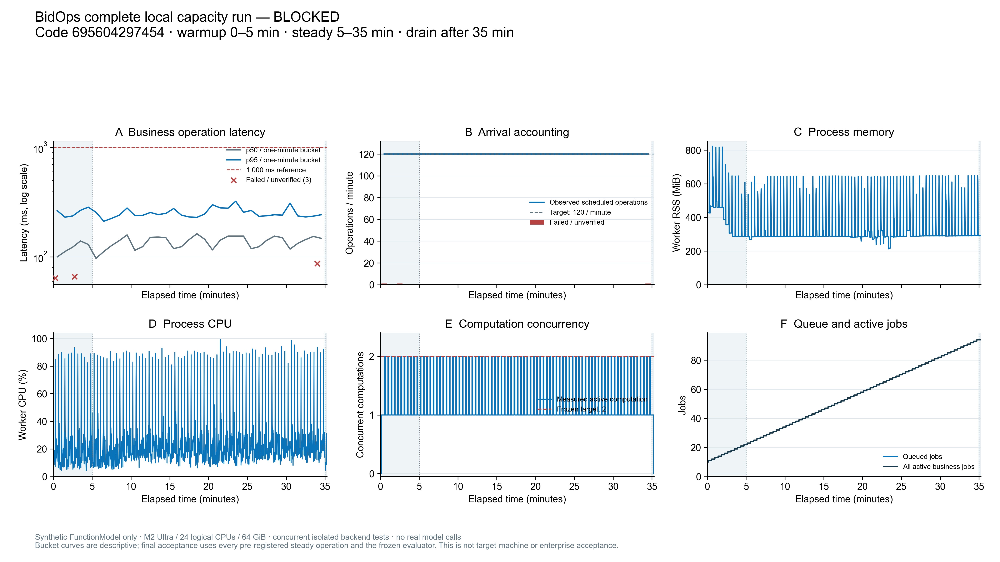

# B09 后续：原生计算队列与版本恢复实际验收

日期：2026-10-23。交付：[Draft PR #26](https://github.com/ZZZZihan/BidOps/pull/26)，依赖 [B10 PR #25](https://github.com/ZZZZihan/BidOps/pull/25)。
固定修复代码 `76ce23720c14e9e66e583e4cc15ad95356f5e519`，负载代码 `69560429745417e34113d0877d75a62d7eb8f37b`，基线 `215fca737e0e466a9781cd020b6b9d3b89e4b43f`。本报告的纯证据提交不是负载被测提交；后续提交身份与CI在PR/交接快照单列。

## 当前结论

新增B09-09/10两项C工程通过；共73项专项为57项C PASS、B02-06一项C BLOCKED、15项B BLOCKED。
G-01/G-03/G-08仍受原真实旧库缺口阻塞，故不能声明整条依赖链已具备合并条件。所有PR保持未合并、未部署。
当前代码[三个CI job](https://github.com/ZZZZihan/BidOps/actions/runs/39874101082)均通过：后端2175项/802.13秒、浏览器159项/1.9m、容器构建与运行检查通过。
新完整本机负载的工程门槛为 **PASS**；官方capacity verdict为 **BLOCKED**，measurement仍BLOCKED。
本轮未调用真实模型、采购来源或发送外部告警，新增真实模型费用0；未核实历史累计¥10余额。

## 变更及选择

旧版完整负载的计算峰值只有1、目标2、双任务重叠0。`JobsService`中的显式Semaphore=1构成实际代码限制。
先用锁定DBOS3.3.0完成六项隔离队列实验，再保留SQLite和单ASGI/SingleWorker，使用框架原生计算子队列。
配置默认1、只接受1或2，native worker/global与实际计算Semaphore使用同一上限；审核等待的父任务不占计算名额。
取消回执不意味着在途provider调用退出，Semaphore仍持有到实际计算finally。显式resume指定父/计算队列，避免落入无界内部队列。
Jobs启用后同步核对接口在正常认证/权限检查后返回409；页面引导持久任务，状态未知时暂停同步提交。
没有改依赖锁或业务schema，没有自建调度器。技术依据和切换步骤见[ADR-0008](https://github.com/ZZZZihan/BidOps/blob/76ce23720c14e9e66e583e4cc15ad95356f5e519/docs/ADR-0008-NATIVE-COMPUTE-QUEUE.md)。

## B09-09 C：计算上限及同步入口

输入为固定提交内合成画像/公告及测试身份，许可仅限本机隔离测试。期望：默认1/允许1或2，双计算真实重叠、第三原生排队；取消中的实际调用仍占名额；待审不占计算；Jobs启用不允许同步绕行，停用保留旧接口。
`tests/test_jobs_compute_queue.py`及`tests/test_jobs_sync_admission.py`覆盖这些行为；Screening浏览器新增7项，当前全套159项浏览器CI通过。
独立Agent在提交前WIP实际执行16项/38.90秒；原6956042的浏览器/容器CI通过，但后端2166通过/1恢复竞态失败；修复后固定76ce237的全套CI另列，不把前者改称提交后重跑。
[框架六场景证据](evidence/b09-native-queue-20261023/framework/EVIDENCE.md)证明真实DBOS/SQLite原生排队、取消、SIGKILL及待审恢复边界，未模拟自制队列。
[独立技术复核](evidence/b09-native-queue-20261023/native-compute-independent-review.md)未发现生产阻塞。
本项状态PASS；完整目标环境容量仍另按B09-02/07。

## B09-10 C：恢复、费用及版本切换

三项真实子进程恢复测试实际3 PASS/39.83秒，共59次本地FunctionModel、0次真实provider：

- 两个计算PENDING、第三ENQUEUED时SIGKILL，重启完成三份独立待审结果；27条确认与2条未知回执保留。第三进程只读新增调用0，原unknown账本行不变。
- 两个计算竞争仅够一次模型请求的费用预留，只有一个provider进入；失败留下unknown后第三任务仍被费用门禁拒绝。
- v4备份实际包含计算队列concurrency/worker_concurrency=2及三个计算任务；恢复后旧任务隔离、缺/错费用确认值均拒绝且0调用。

这是提交前工作副本上的实际测试。完整backend及三锁应用版本与6956042一致、测试文件hash相同，证明源码字节对应；没有补造clean提交后重跑或精确UTC时钟。
[恢复证据JSON](evidence/b09-native-queue-20261023/native-compute-recovery-evidence.json)和[非实现者代码复核](evidence/b09-native-queue-20261023/native-compute-contract-review.md)分别留证。

另执行四个新进程的真实版本切换/回退，均exit0：旧clean215fca7创建待审任务及配套双库备份，新clean6956042启动后旧任务中断于application_version_changed，历史结果可读、新增调用0。
旧代码配原备份恢复到新目录后，身份新鲜度清零、私有对象/结果/任务隔离；旧身份读取拒绝，只刷新合成身份仍因任务隔离拒绝；源未重授权时，任务重授权拒绝。随后显式源授权与任务重授权只进入interrupted，再显式resume。
明确重授权及resume后，第二次独立恢复确认原生父PENDING、计算子SUCCESS；原9条离线request/response/usage收据及结果元数据不变、新调用0，人审仍unreviewed，费用屏障仍要求确认；该探针未验证真实账本。
第一次恢复停机时ENQUEUED仅为保留的历史观察，原快照已被覆盖，独立复核不能重新证明；第二次PENDING具有真实事件/快照。未用第一次状态代称完成。
401/404/409是进程内CompanyError状态值，未执行真实HTTP传输；HTTP接口证据来自独立API/浏览器测试。
[四阶段安全投影](evidence/b09-native-queue-20261023/upgrade/REPORT.public.md)保留实际命令、UTC和源hash，不包含数据库、token或本机路径。
本项状态PASS；此合成旧/新版切换不替代B02-06指定真实六公告旧库迁移，不是业务RTO或人工验收。

## 未降低阈值的完整规模复验

新manifest只改profile标识与configured_compute_concurrency 1→2，旧manifest和旧FAIL完整保留；规模、并发目标2、请求比例、超时、错误率和窗口未变。
[逐字段差异](evidence/b09-native-queue-20261023/manifest-delta.json)记录旧hash `bd82c7ab050a53610742515d4af082140f6fce5593b203cabaa4e847ffb4a170`，新hash `8d232aa52fdc5b60bbdf32c258aaa964585b3faf2e5b4b50f7d75349a00c043c`。
输入：10000公告版本、50000采购包、200材料、1000附件、20账号、10客户端。冻结到达2个业务操作/秒，读/状态/提交/审核78/18/2/2，FunctionModel延迟30秒，0重试。
命令在clean6956042上实际执行，输出目录采用独立新目录：

```sh
.venv/bin/python scripts/capacity_probe.py --output "$CONTROLLED_OUTPUT" \
  --manifest evals/capacity-native-queue-v2/manifest.json \
  --manifest-sha256 8d232aa52fdc5b60bbdf32c258aaa964585b3faf2e5b4b50f7d75349a00c043c
```

从 `2026-10-22T22:55:14.481055Z` 开始，5分钟预热、30分钟稳态、15.0秒排空；自然退出2。
4200操作全部保留，稳态3600；所有失败/无响应计入分母。独立算术复算与冻结评估器指标一致。

| 指标 | 旧836实测 | 新6956042实测 |
|---|---:|---:|
| 计算峰值/冻结目标 | 1 / 2 | 2 / 2 |
| 稳态双计算重叠 | 0 ms | 409609 ms |
| 稳态错误/3600 | 4 | 1 |
| 合并非模型等待API P95 | 263 ms | 259 ms |
| 任务受理 P95 | 108 ms | 109 ms |
| 队列等待 P95 | 480734 ms | 306 ms |
| 计算 P95（含模型等待） | 31774 ms | 30868 ms |
| 队列峰值 | 17 | 0 |
| worker RSS峰值 | 817 MiB | 823.8 MiB |

新运行全部时段无响应/未验证错误3，与稳态1分别记账；返回HTTP失败码0不意味着无网络异常。
全部4200次操作中4197次收到响应，3次ReadError分别发生于预热2次、稳态1次；稳态错误率1/3600=0.0278%，没有删去失败再计算分母。
分操作的稳态P95另为检索250ms、状态100ms、受理109ms、审核1362ms；审核单类超过1秒。
冻结的官方阈值适用于合并API指标，故本机门槛仍PASS；这不支持“每类接口P95都小于1秒”的结论。
84份测量任务在结束快照的状态为 `{"waiting_review": 84}`；待审不等于人审通过，也不等于持续占用计算。
末次资源采样为compute_active=0、queued_jobs=0、active_jobs=94；后者包含84份测量任务和10份准备任务，不能写成全部任务completed或active_jobs=0。
实测开发机M2 Ultra/24逻辑CPU/64GiB，目标4CPU/8GiB未执行。其他隔离后端回归与准备/预热/部分稳态共享主机资源，不能声称独占机器或线性推算目标吞吐。
因此本机工程门槛PASS，官方总体capacity BLOCKED；目标机容量、业务RPO/RTO及企业验收仍BLOCKED。真实模型吞吐未验证；B09-02本身允许按冻结模拟延迟复验，不额外要求付费模型才能通过该容量条目。

[完整安全指标](evidence/b09-native-queue-20261023/full-load/safe-report.json) · [HTTP分母](evidence/b09-native-queue-20261023/full-load/http-summary.json) · [全部原件hash](evidence/b09-native-queue-20261023/full-load/source-provenance.json) · [根Agent算术复算](evidence/b09-native-queue-20261023/full-load/recomputed-metrics.json) · [分操作延时](evidence/b09-native-queue-20261023/full-load/operation-breakdown.json) · [非实现者独立复核](evidence/b09-native-queue-20261023/native-final-load-independent-review.md)



## 集成验证、失败保留与共同门槛

本机提交前全套后端：2167 PASS/721.51秒，归因提交前工作副本。原6956042的Linux后端为2166 PASS/1 FAIL/840.00秒，前端159及容器通过；失败来自真实调度恢复竞态，保留[初次CI失败](evidence/b09-native-queue-20261023/initial-code-ci-failure.json)。采集修复2425fc2的下一轮Linux CI为2172 PASS/3 FAIL/1274.81秒，三个失败均为计算队列测试的12秒等待；[该次失败](evidence/b09-native-queue-20261023/queue-state-ci-failure-2425.json)同样保留。
原队列测试从释放前两任务的首个模型响应起，用同一个12秒期限覆盖余下业务计算和第三任务入场；它实际只需至少一个前驱释放名额，不能把这段时间全归为放行延迟。完成态观察也使用12秒短期限。修正测试为显式等待计算child完成（沿用实际90秒业务执行期限）后，再检查12秒内第三任务放行；并发、取消、结果数、真实DBOS状态和用量断言保留，生产队列及冻结性能阈值未改。受控每次响应延迟2秒的红绿实测与独立复核另列。
[队列测试同步独立复核](evidence/b09-native-queue-20261023/native-queue-lifecycle-test-review.md)与[受控慢速红绿](evidence/b09-native-queue-20261023/queue-lifecycle-regression/summary.json)记录各次命令、UTC、源码hash与真实原生状态；正常6项与慢速3项分别执行，不相加成同一测试集成绩。
最终固定76ce237的[实际完整CI](https://github.com/ZZZZihan/BidOps/actions/runs/39874101082)为后端2175 PASS/802.13秒、1条warning，浏览器159 PASS/1.9m，容器构建与smoke通过；Actions实际检出合并树与修复代码树完全一致。
该warning来自锁定DBOS的`start_workflow_task`协程未被await，出现在既有撤权后显式恢复测试；测试通过与警告分别记录，不声称零警告或已确定其根因。原警告完整摘录保留在[CI记录](evidence/b09-native-queue-20261023/fixed-code-ci.json)。
此前工程过程中三项早期失败分别是编辑中版本hash变化、取消后错误期待SDK立即受理第三任务、UAT未来门槛ID与新增B09-09撞名。修正代码/断言后定向通过，原日志hash与原因保留，不删失败来扩大成绩。
固定6956042及后续修复clean代码的UAT模板/空环境/空证据分别实际退出0/2/2，67项上游、六项B10 BLOCKED、NO_GO，0模型/网络。
完整验收映射见[73项矩阵](enterprise-current-acceptance-20261023.md)及[结构化明细](enterprise-current-acceptance-20261023.json)。
G-02/04/05/06/07在本次工程范围通过；G-01/03/08仍因B02-06真实旧库未提供而BLOCKED。新合成回退证据不清除此缺口。

## B07-06 既有恢复标准的CI修复

原CI在after_schedule_run_commit中断恢复窗口暴露真实竞争：恢复扫到queued并派发采集，schedule复读旧queued后再次校验时，采集已completed，ingestion_run_not_active被持久化为原生ERROR。没有通过重跑或扩大35秒期限掩盖失败。
独立Agent用真实DBOS/SQLite和Event屏障确定性重现，旧代码1 FAIL/8.10秒；生产只对精确not_active且复读completed/partial/failed做无派发返回，使用守卫返回的最新记录，取消/撤权/版本/来源等其他错误继续拒绝。业务终态不改写为completed。
[红绿与负例证据](evidence/b09-native-queue-20261023/ingestion-schedule-replay/summary.json)记录真实HTTP计数、原生状态、重复启动不新增行、执行UTC/命令及原件hash；[既有恢复测试及独立复核](evidence/b09-native-queue-20261023/ingestion-recovery-independent-review.json)保留原三处SIGKILL窗口及相关守卫验证。
本修复满足既有B07-06，并回归B07-02/04；未新增业务标准，也不改变B07-07真实许可运行的BLOCKED。
负载保持clean6956042直到自然结束，修复另在独立工作区完成。[差异范围证明](evidence/b09-native-queue-20261023/load-to-fixed-code-scope.json)确认后续生产修复只触及采集调度，其余为两份测试调整，负载运行时采集关闭；计算/容量代码与manifest相同。采集修复改变应用版本hash，随后测试调整不再改变它；容量结果严格归因6956042，不伪称在新提交完整重跑。

## 剩余输入、运行和回退

下一项可以直接执行的是取得E01原旧六库/raw/附件/业务历史/对应旧代码的受控路径，以及E06完整累计费用账本路径；二者可分别只读核查和隔离执行，不必等待IdP/金标全部齐备。
随后按对应验收补齐许可与新独立项目族、独立标注/计时人员、真实IdP/HTTPS/授权企业材料与两名用户、目标机器和实际告警收件范围。
没有这些条件的项继续BLOCKED；本报告不授权真实模型调用、解除unknown预留、外部发送、合并或部署。
默认Jobs仍关闭、计算1。启用/配置2须依部署范围验证；切换前停接收与worker并做v4配套双库及文件备份。回退使用旧代码与旧配套备份到新目录，保留升级后的历史；不可只换二进制、伪造application_version或删除历史。

本次3名子Agent实质参与：框架实验/独立复核，恢复/预算测试及生产复核，API/界面与旧版切换回退。请求配置均GPT-6.1 Sol/ultra；主Agent沿用用户许可的GPT-6 Astra/max。未独立核验供应商实际运行档位。Agent技术复核不代替独立人审或用户验收。
